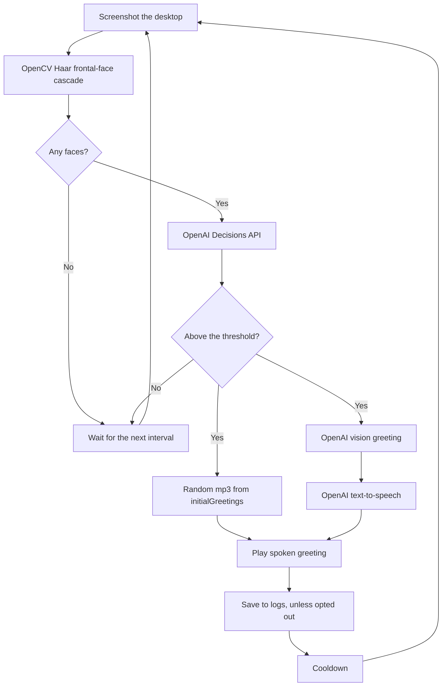

# Halloween AI Greeter

Screenshots a camera feed on your desktop, decides whether the people in view are trick-or-treating, and speaks a Halloween greeting.

## Quickstart

1. Open a doorbell or porch-cam feed and maximize it. The app screenshots the whole desktop, so that window is what it sees.
2. Set the PC's audio output to a Bluetooth speaker near the door.
3. `npm install`
4. Create a `.env` file with your OpenAI API key ([get one here](https://platform.openai.com/api-keys)):

   ```env
   OPENAI_API_KEY=sk-proj-your-api-key-here
   ```

5. `npm start`, then minimize the console so it is not in the screenshot.

Requires Node.js >= 22.9.0. If `.env` is missing, startup continues and greetings fail until the key is set.

## What happens



The intro mp3s live in `initialGreetings`, including Creative Commons ghost samples from [freesound.org](https://freesound.org). Any extra `.mp3` you add is included. One file is chosen at random. The greeting text and the intro start together. Speech is generated as soon as the text is ready, while the intro is still playing. The spoken greeting plays after the intro finishes.

Each saved greeting is `123.json` (timestamp, face count, intro file, greeting text, speech file name, and the image) and `123.mp3`. The `logs` folder is in git; the files inside it are gitignored. Set `LOG=false` to skip saving. The greeting is still spoken, and the mp3 is deleted after playback.

## Settings

Optional values in `.env`. Shown with their defaults:

```env
INTERVAL_MS=1000
COOL_DOWN_MS=60000
MAX_DIMENSION=800
MIN_DIMENSION_PERCENTAGE=0.05
TTS_VOICE=coral
TTS_MODEL=tts-1
OPENAI_MODEL=gpt-6-luna
OPENAI_REASONING=none
DECISION_MODEL=gpt-6-luna
DECISION_THRESHOLD=0.6
DECISION_QUESTION=Is someone approaching, waiting for a treat, or engaging the camera in a costume, mask, or hat? Answer no if people are only walking past or in the background.
```

- **`INTERVAL_MS`** — milliseconds between screenshots. Minimum `100`. A capture waits until the previous one finishes.
- **`COOL_DOWN_MS`** — pause after a greeting before detecting again. Minimum `0`.
- **`MAX_DIMENSION`** — longest side of the screenshot before face detection, in pixels. Minimum `160`. Smaller images are left as they are.
- **`MIN_DIMENSION_PERCENTAGE`** — minimum face size as a fraction of the longest side (`0.05` is 5%).
- **`LOG`** — `false`, `0`, `no`, or `off` skips writing greetings to `logs`. Default is on.
- **`TTS_VOICE`** — `alloy`, `ash`, `ballad`, `coral`, `echo`, `fable`, `onyx`, `nova`, `sage`, `shimmer`, `verse`, `marin`, `cedar`.
- **`TTS_MODEL`** — `tts-1` or `tts-1-hd`.
- **`OPENAI_PROMPT`** — greeting instructions. Default is a built-in Halloween prompt.
- **`OPENAI_MODEL`** — vision model for the greeting. Default `gpt-6-luna`.
- **`OPENAI_REASONING`** — `none`, `minimal`, `low`, `medium`, `high`, `xhigh`, `max`.
- **`DECISION_QUESTION`** — yes/no question asked about each image before greeting.
- **`DECISION_THRESHOLD`** — probability from 0 to 1 required before a greeting. Default `0.6`.
- **`DECISION_MODEL`** — Decisions model. Default `gpt-6-luna` (the only model that endpoint supports).

## Troubleshooting

- **No greetings**: Check `OPENAI_API_KEY` and that the account has credits.
- **Poor face detection**: Raise `MAX_DIMENSION` or lower `MIN_DIMENSION_PERCENTAGE`.
- **Too many greetings**: Raise `COOL_DOWN_MS` or `INTERVAL_MS`.
- **No audio**: Set the PC playback device to the Bluetooth speaker, and check that `TTS_VOICE` is a voice such as `coral`.

## License

MIT
